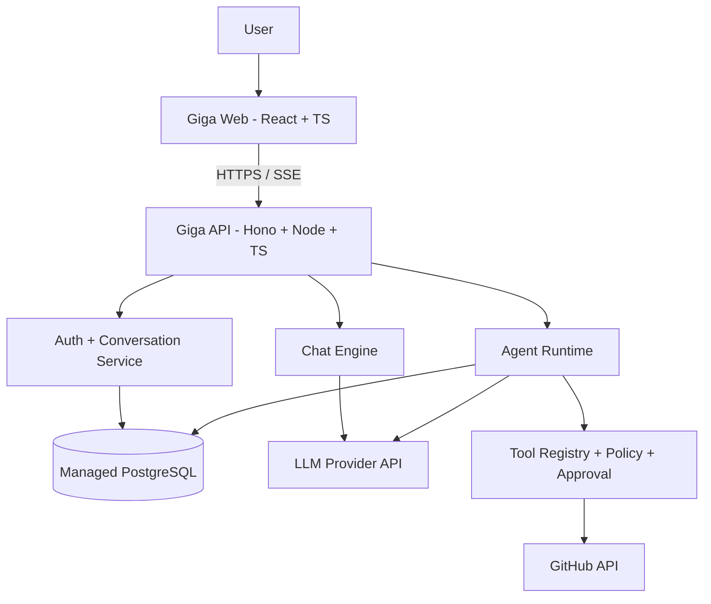

# Giga — Project Plan v0.1

> **Baseline:** 2026-10-12 · **Status:** Planning/approved direction · **Team:** Trà + Thư · **Subject:** Điện toán đám mây
> **Canonical document:** GitHub repository. **Tracking:** [Linear — Giga Cloud Mini-Project](https://linear.app/17thedev/project/giga-cloud-mini-project-0656a578ee3b).
> **Companion specs:** [API Contract v0.1 — draft](contracts/API_CONTRACT_V0.1.md) · [Architecture Invariants](architecture/INVARIANTS_V0.1.md) · [ADR-001](decisions/ADR-001-api-compatibility.md) · [Week 01 daily tasks](planning/W01-daily-plan.md) · [Team workflow](TEAM-WORKFLOW.md).

## 1. Problem statement

Giga is a public-cloud-deployed AI web application with two product flows: (1) multi-turn AI Chat and (2) a tool-using Coding Agent that inspects a user-authorized demo GitHub repository, analyzes code, produces an explicit diff/proposal, and creates a pull request only after approval. This is a **cloud computing mini-project**: developing the product is the means; deployment, operations, cost/security controls, evidence, and team cross-training are core learning outcomes.

- **Inputs:** user credentials/session; messages; past conversation context; agent task; repository reference and granted permission.
- **Outputs:** streamed assistant responses; durable chat history; agent event log/tool results; proposed diff; approval decision; GitHub PR link.
- **Users:** project demo participants (student group and instructor). Production-scale multi-tenancy is outside v0.1.

## 2. Decisions and pending choices

| Decision | Status | Rationale |
|---|---|---|
| TypeScript as the main language | **Decided** | Shared language across frontend and backend |
| Trà: backend + coding agent | **Decided** | Split by engineering responsibility |
| Thư: frontend + UX | **Decided** | Split by engineering responsibility |
| Cloud work split ~equally and cross-trained | **Decided** | Course grading focuses on cloud operations |
| GitHub canonical docs/code, Linear project/task tracking | **Decided** | One source of truth, linked execution board |
| React + Vite frontend | Proposed | Confirm in W1 architecture review |
| Hono + Node.js API, SSE | Proposed | Confirm in W1 architecture review |
| PostgreSQL + Drizzle ORM | Proposed | Confirm in W1 architecture review |
| Render for web/API + Neon for managed PostgreSQL | Proposed | Validate tiers/limits/pricing in W1 preflight |
| GitHub API tools and LLM API provider | Proposed | Select credentials, budget, access policy |

## 3. MVP and exclusions

### MVP requirements

1. Authentication: login/logout, safe session, validation and unauthorized states.
2. AI Chat: multi-turn messages, streaming responses, conversation create/list/open/delete, persistence.
3. Agent Core: bounded agent loop (LLM -> tool calls -> results -> LLM), tool registry, states/events, cancel/error/timeout.
4. GitHub coding tools: list/read/search demo repo, analyze files, prepare diff, approve/reject explicitly, then commit/PR via authorized credentials.
5. Agent UI: task entry, progress timeline, tool result, diff viewer and approval controls.
6. Public Cloud: frontend and API over HTTPS, managed DB, deployment process, CI/CD, server secrets, health checks, logs, resource/cost monitoring, incident/rollback drill.
7. Evidence: public URLs, sanitized screenshots, log extracts, testing record, deployment guide, cross-training signatures.

### Explicit non-goals

- Do not train/self-host an LLM or implement an IDE, arbitrary shell execution, container sandbox or unrestricted code execution in v0.1.
- Do not use the app server's ephemeral disk as durable data storage.
- Scale back advanced agent features before cutting cloud operations or report evidence.

## 4. High-level system architecture

**Repository organization (planned):** `apps/web`, `apps/api`, `packages/contracts`, `infra/docker`, `infra/render`, `docs/architecture`, `docs/cloud/runbooks`, `docs/evidence`, `.github/workflows`.

Frontend and backend use a signed-off shared API contract, with mocks available for parallel development. The app must not expose provider or GitHub secrets to the browser.

## 5. Ownership matrix

| Workstream | Primary owner | Secondary/cross-training requirement |
|---|---|---|
| API skeleton, auth, chat SSE, persistence, tests | Trà | Thư reviews API contract and validates cloud deployment |
| Agent runtime, GitHub tooling, diff + approval + PR | Trà | Thư demonstrates UI control and traces tool events |
| Frontend components, auth/chat UI, history | Thư | Trà builds and deploys frontend from scratch |
| Agent workspace, event timeline, diff/approval UX | Thư | Trà reviews workflows and tests API/UI integration |
| Cloud API, Docker, health endpoints, CI/CD | Trà | Thư repeats deploy, diagnoses errors from logs |
| Cloud frontend, HTTPS/CORS, secret configuration | Thư | Trà repeats frontend deploy and HTTPS/CORS checks |
| Managed PostgreSQL provisioning/configuration | Thư | Trà runs safe migrations and a restore drill on test DB |
| Application logs, rollback, incident handling | Trà | Thư runs an incident drill and records evidence |
| Quotas, usage/cost tracking, monitoring dashboard | Thư | Trà checks alarms, LLM cost/step limits |
| System integration, report, security/E2E test, demo | Both | Peer review and role switching |

**Effort allocation target per person:** ~40% coding, ~40% cloud delivery/operations, ~20% test/evidence/report/demo. Log actual effort in Linear rather than using commit count as a proxy.

**Thư's Linear issues stay unassigned until she joins the workspace; descriptions still explicitly identify the intended owner.**

## 6. Four-week roadmap (proposed; not instructor deadline)

| Week | Dates | Development | Cloud / evidence | Acceptance gate |
|---|---|---|---|---|
| W1 | 12–18 Oct 2026 | Requirements, UI flows, DB schema, API contract, scaffolds | Cloud account/tier preflight; deploy frontend/API hello-world | 2 public test URLs; reviewed design + board |
| W2 | 19–25 Oct 2026 | Auth, streaming Chat, conversation persistence/UI | Managed DB, HTTPS, CI/CD, secrets, health | Login/chat/history works via public HTTPS |
| W3 | 26 Oct–01 Nov 2026 | Bounded Agent, GitHub read tools, diff, approval, PR UI | Logs/monitoring/cost controls, rollback & incident drill | Agent safely opens PR on demo repo after approval |
| W4 | 02–08 Nov 2026 | Bug fixing, security/E2E tests, final integration | Cross-training role swap, runbooks, evidence collection | Report ~20 pages, 7 sections, successful end-to-end demo |

### Weekly cross-training

- Schedule one 45–60 minute peer session per week. Each person *operates* the other person's cloud workstream on staging/test resources, not merely observes a screen share.
- For each session record: operator, reviewer, environment, scenario, screenshots/logs with secrets removed, PASS/FAIL, follow-up issue, and link to runbook.
- Examples: Thư deploys API and fixes a PostgreSQL connection failure from logs; Trà deploys SPA and checks HTTPS/CORS; each explains the entire architecture under questioning.

## 7. Cloud safety, reliability and budget

- Use least-privilege GitHub permissions, server-side secrets, explicit approval for all remote writes, tool allowlisting, rate limits, token/step ceilings and timeouts.
- Verify free-tier constraints and payment policies **on the day of provisioning**; no claims of permanent free operation.
- Store durable conversations and agent run state in managed database; do not depend on filesystem state surviving cloud restarts.
- CI/CD must show build/test evidence and traceable deploy commit; provide a rollback procedure and failure-handling demo.
- Screenshot dashboards and logs with access tokens, keys, session IDs and customer data redacted.

## 8. Instructor report mapping (~20 A4 pages)

| Part | Target pages | Responsible | Evidence |
|---|---:|---|---|
| 1. Problem, inputs/outputs, solution | 2 | Trà | Use cases, architecture |
| 2. Cloud service choice, features, suitability | 3 | Thư | Console/screenshots, tier comparison |
| 3. Task allocation | 1 | Both | Linear board, ownership matrix, effort |
| 4. Implementation plan | 2 | Both | Roadmap, acceptance gates |
| 5. Cloud deployment steps with images | 6 | 3 pages each | Config/console screenshots, commands, logs |
| 6. Running product, features, usage | 4 | Both | Chat, agent, PR, public URL |
| 7. Conclusion and future directions | 2 | Both | Limitations, future sandboxed worker |

**Demo order:** explain problem -> cloud deployment -> HTTPS/public UI -> auth/chat/history -> agent tool timeline/diff/approval -> demo PR -> health/logs/monitoring -> conclusions and further work.

## 9. Definition of Done

- [ ] Use cases, API contract, schema and architecture reviewed by both.
- [ ] Auth, streaming AI Chat and durable conversation history work on public HTTPS.
- [ ] Agent runs bounded multi-step tools; proposed diff is visible; GitHub remote write requires approval.
- [ ] Cloud has frontend, API, PostgreSQL, CI/CD, health, logs, quotas and failure response evidence.
- [ ] Both members have independently deployed and troubleshot the other's cloud module.
- [ ] Sanitized evidence and repeatable runbooks exist; report covers all 7 required sections.
- [ ] Demo script, fallback evidence and division of presentation are tested.

## 10. Change control and next actions

Any major change in stack/scope/schedule or team responsibilities requires a documented PR update to this baseline (or a newer version), with decision rationale and corresponding Linear issues. Do not silently rewrite v0.1.

1. Confirm W1 API contract and DB model.
2. Validate cloud vendor plan details and available credits before entering payment info.
3. Complete frontend/API public hello-world deployments.
4. Invite Thư into Linear and assign her tasks; schedule cross-training.

**Linked systems:** [GitHub](https://github.com/17thedevv/Giga) · [Linear project](https://linear.app/17thedev/project/giga-cloud-mini-project-0656a578ee3b) · [Original Notion draft (historical)](https://app.notion.com/p/3f7368d81eff81e68586c11553d64802)