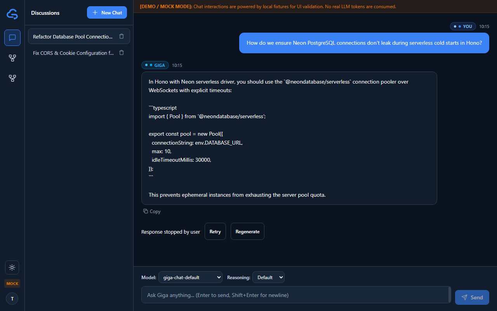
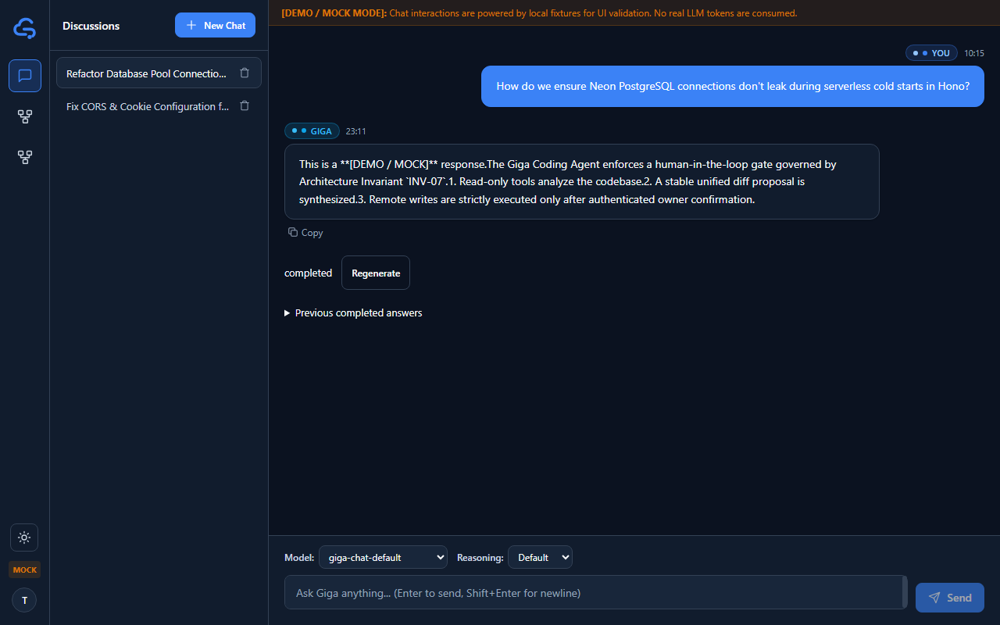
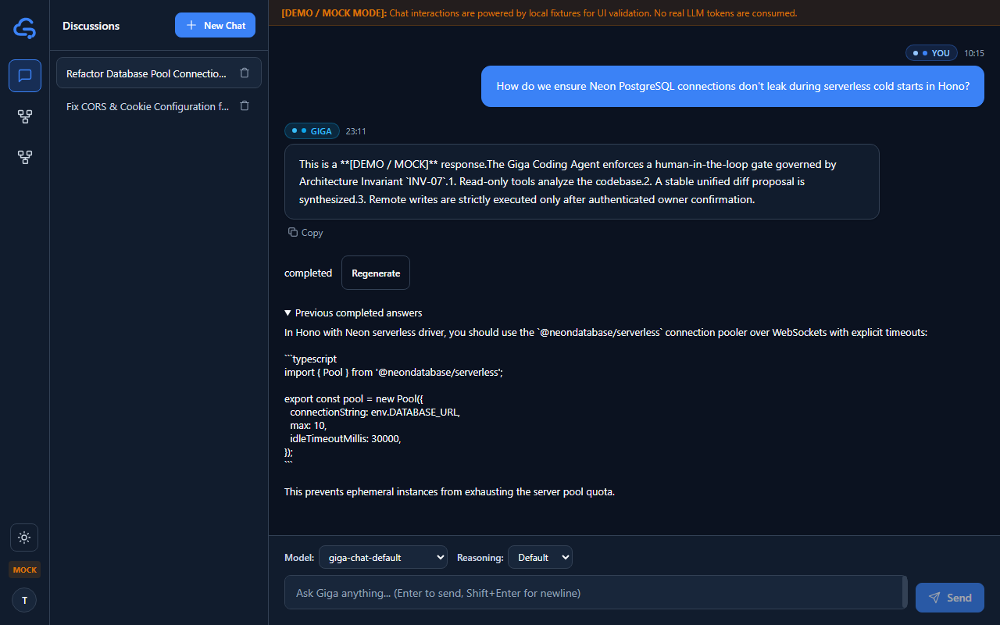
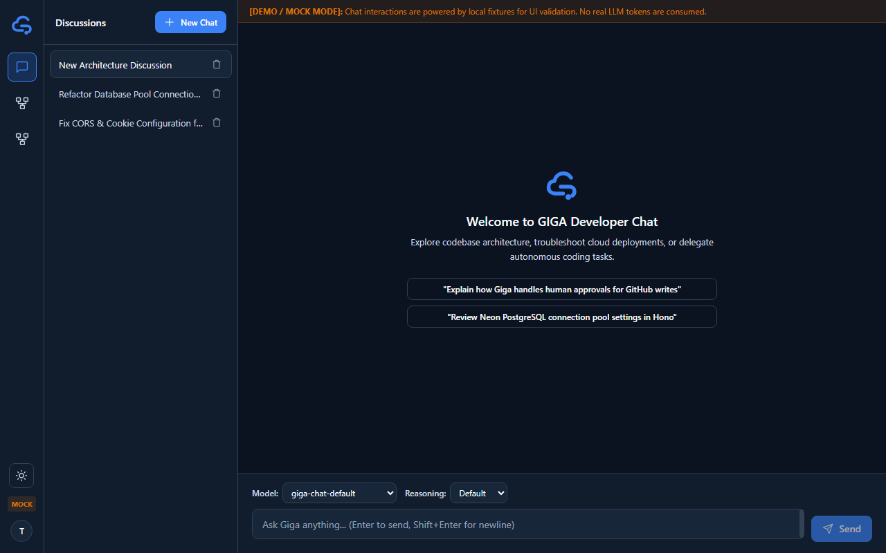

# Chat generation controls — local evidence

Issue: [17T-38](https://linear.app/17thedev/issue/17T-38/implement-gigachat-stop-retry-and-regenerate-controls-ui).
Intended owner: Thư. Reviewer: Trà; re-review remains pending after Request Changes.
Date: 2026-10-16 (Asia/Saigon).

## Scope and compatibility

Web-only implementation plus this evidence directory. The backend, database, auth,
Agent and shared contract files are unchanged. The API remains **DRAFT**.
`packages/contracts` still contains no executable shared DTOs; local web DTOs mirror
the implemented runtime contract and backend types.

| Previous client behavior | New behavior | Compatibility / evidence |
| --- | --- | --- |
| Partial failed regeneration could replace the selected answer | Reconcile selected completed answer from history and latest-turn variants; retain alternatives | Existing GET endpoints and envelopes; no server changes |
| Retry depended on a partial assistant bubble | Latest attempt status controls Retry, including zero-output failed/stopped/interrupted attempts | Existing variants DTO; refresh and admission tests |
| Nonterminal/error polling could re-enable generation actions | Retain synchronous action lock and offer status/Stop recovery | Existing generation GET and cancel semantics |
| Duplicate stream handlers could race across route/mode changes | Operation and mode fences isolate callbacks and reconciliation | Existing route/mode regression tests |
| Mock inspection fabricated completed state | Track mock attempts and completed-only selection independently from Real | Dedicated mock regression test |

No variant selection write endpoint or earlier-turn branching is introduced.
Completed-only selection follows durable completion or its terminal SSE. A stopped
candidate is distinct from failure and does not displace a selected completed answer.

## Executed validation

Environment: Windows, Node v24.12.0, npm 11.6.2. Base: `6dc2b1a` from `origin/main`.

- `npm ci` in `apps/web`: succeeded; lockfile unchanged. npm reported three existing dependency audit findings (one moderate, two critical); no dependency upgrades were made.
- `npm run typecheck --prefix apps/web`: PASS.
- `npm run build --prefix apps/web`: PASS.
- `npm test --prefix apps/web`: PASS, 129 tests across 10 files (23 focused generation-control tests).
- `node --test .agents/scripts/validate-git-workflow.test.mjs`: PASS, six tests.
- `node .agents/scripts/validate-skills.mjs`: PASS, eight skills.
- `git diff --check`: PASS.

Focused coverage includes Stop/stopped SSE, completion winning Stop, lost cancel
response, latest-turn Retry without output, failed/stopped regeneration preserving
selection, duplicate admission envelopes, admission discovery before started,
synchronous double actions including conversation creation, active-generation route
refresh, Enter-to-send, cross-conversation stop prevention, late SSE event isolation,
model and reasoning effort preservation on regenerate, and rapid conversation switching.
Existing stream, model capability, auth and other web regressions remain in the full suite.

## Review follow-up: stale operations and duplicate active admission

Reviewed head: `840075e`. Both reported P1 cases were reproduced by new deferred
promise regression tests before the fixes (16 focused tests passed, two failed).

- A late creation rejection now checks operation, mode and route before releasing
  state or showing an error. The test navigates from pending creation at `/chat`
  to conversation B, starts B's generation, then rejects the old request. B keeps
  its action lock, accepts later deltas and sends Stop for its own generation ID.
- The same route fence now covers a late history-recovery rejection. A third test
  verifies that this related failure cannot hide B's ongoing stream.
- A same-conversation duplicate admission enables Stop for its nonterminal
  generation before GET completes. Authoritative nonterminal GET responses keep
  Stop enabled through bounded polling while new actions remain locked. The test
  then cancels that generation and reconciles stopped state.

## Review follow-up: cross-conversation stop prevention and late SSE isolation

- An `activeGenerationConversationIdRef` tracks the owning conversation ID alongside
  each active generation ID.
- `handleStopStreaming` strictly fences against mismatched conversation IDs, ensuring
  the client never sends `(conversation B, generation A)` when navigating during streaming.
- SSE callbacks and `reconcileAuthoritativeGeneration` verify route and owning
  conversation IDs so late events arriving from conversation A cannot mutate conversation B.
- Retry and Regenerate preserve currently selected `modelId` and `reasoningEffort`.
- 4 additional regression tests added to `chat-generation-controls.test.tsx` (bringing suite to 23 tests, 129 total web tests).

## Local browser evidence

Browser verification at `http://127.0.0.1:4173/chat?demo=1` (1280 × 800 viewport):

1. Stop generation: Clicking Regenerate followed by Stop cancels streaming, updates
   status to "Response stopped by user", and keeps Retry and Regenerate available.
2. Retry generation: Resumes generation to completion and displays the new variant.
3. Regenerate & Previous answers: Generates another variant; previous completed
   answers are preserved in the expandable `
` section.
4. Navigation during active stream: Navigating to New Chat during stream cleanly
   unmounts and resets without route contamination or orphan Stop dispatches.

## Checks not executed / review gates

- No deployed Real API browser test, cloud deployment, production writes or new
  provisioning. Cookie/CORS/CSRF and provider behavior need the existing approved
  integration environment with the backend owner.
- No backend/database tests: no backend/database changes.
- No standalone lint/format script exists in `apps/web/package.json`.
- Mock fixtures live in memory and reset on full page reload. Real refresh reads
  durable history and latest-turn variants; automated tests cover this path.
- Trà's independent review and public browser integration remain open. Keep the PR
  Draft; do not merge or mark the issue Done. No cloud cross-training was performed
  or required by this local frontend implementation.
