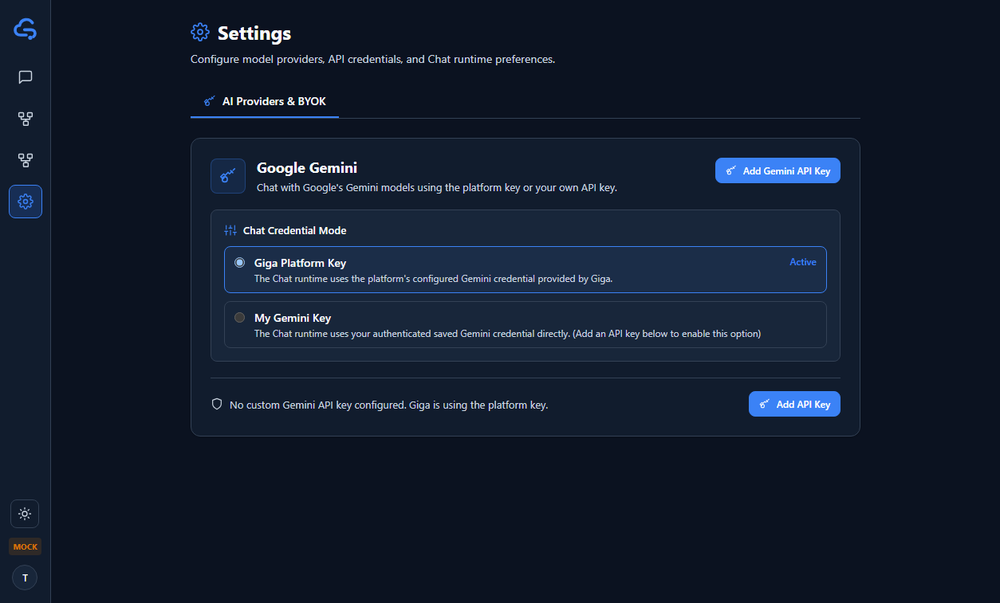
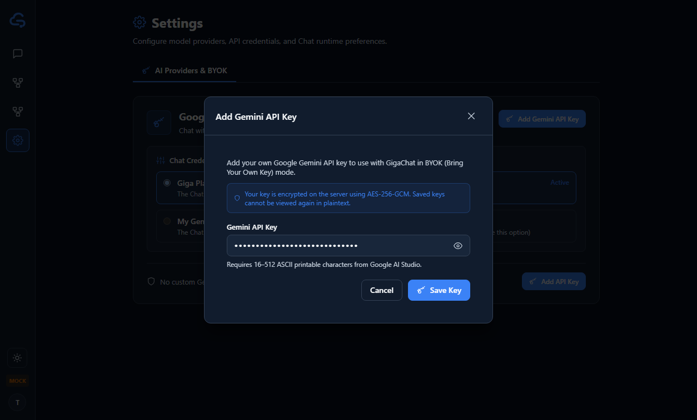
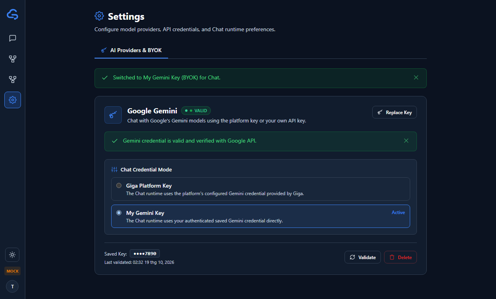
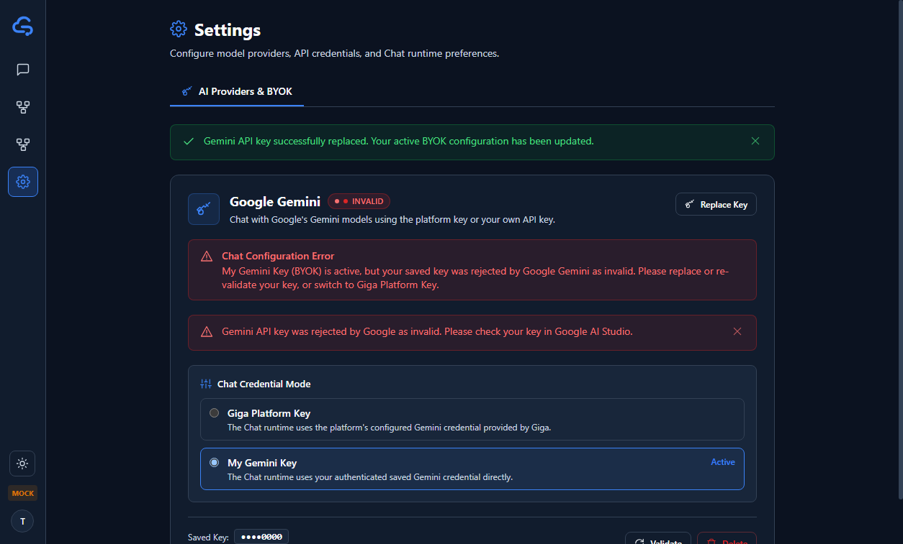
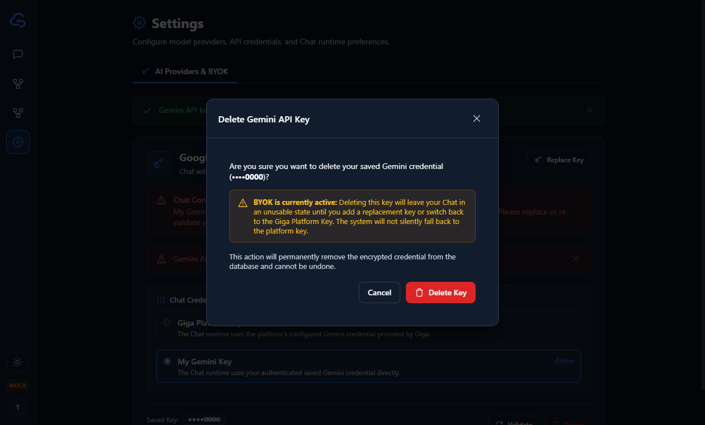
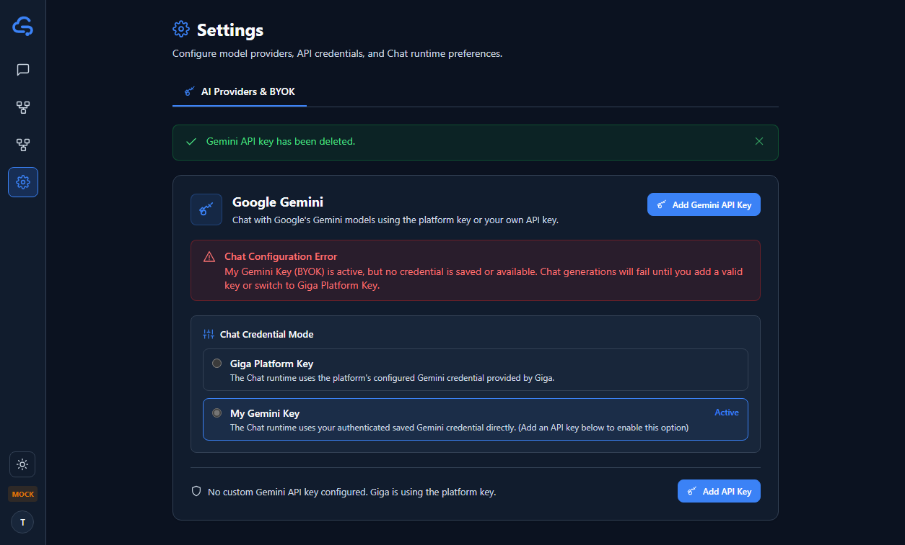
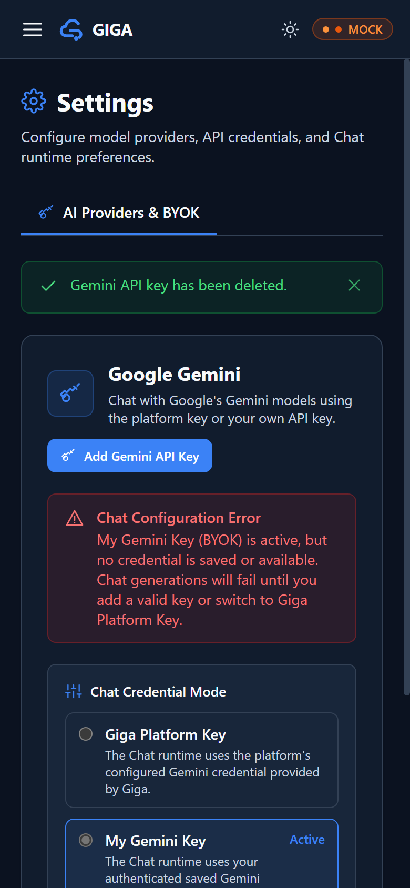

# Gemini BYOK Settings & Credential UX — Local Evidence

Issue: [17T-39](https://linear.app/17thedev/issue/17T-39/implement-gemini-byok-settings-and-credential-ux).  
Backend dependency: [17T-37](https://linear.app/17thedev/issue/17T-37/implement-backend-credential-storage-encryption-and-validation-apis) (merged in `main`, ADR-006).  
PR: `feat(web): add Gemini BYOK settings UI`.  
Branch: `feat/17t-39-byok-settings-ui`.  
Date: 2026-10-19 (Asia/Saigon).  

---

## 1. Scope & Architecture

Web frontend implementation for Bring Your Own Key (BYOK) credential management and chat credential mode selection, backed by the authoritative backend credential API from ADR-006.

### Architectural Invariants & Security Guarantees
- **No Plaintext Key Retention**: API keys are submitted strictly over TLS via `POST /api/v1/me/provider-credentials`. The frontend holds plaintext input only in component-local form state during entry, immediately zeroing and clearing state upon modal submit or dismissal. Plaintext is never stored in browser storage (`localStorage`, `sessionStorage`, IndexedDB), query parameters, or client telemetry.
- **Masked Key Display**: Only the backend-derived safe masked hint (`••••<last4>`) is received and rendered in UI markup.
- **Authoritative Credential State**: Follows backend ADR-006 contracts:
  - `GET /api/v1/me/provider-credentials`: Returns `ProviderCredential[]` (1 per provider type).
  - `POST /api/v1/me/provider-credentials`: Atomic insert or replace with AES-256-GCM backend encryption and automatic rebind if BYOK active.
  - `DELETE /api/v1/me/provider-credentials/:id`: Deletes credential; if active in BYOK, preference retains `mode: 'byok'` with `credentialId: null`.
  - `POST /api/v1/me/provider-credentials/:id/validate`: Triggers server-side key validation using empty payload `{}`.
  - `GET /api/v1/me/chat-credential-preference`: Retrieves active chat credential mode (`platform` vs `byok`).
  - `PUT /api/v1/me/chat-credential-preference`: Updates mode to `platform` or `byok`.
- **Zero Silent Fallback**: When `mode === 'byok'` and no usable credential exists (e.g. key deleted or missing), the UI displays a prominent `byok-configuration-error` banner notifying the user that BYOK is active without an active key. The system never silently falls back to the platform key when the user explicitly chose BYOK.
- **Transient Failure Resilience**: Network errors and transient upstream failures (429 rate limit, 503 service unavailable) during validation do not overwrite or invalidate previously valid credentials.
- **Dual Runtime Support**: Fully functional under both `mock` (demo mode with comprehensive mock adapter simulation) and `real` backend environments.

---

## 2. Executed Validation Summary

Environment: Windows, Node v24.12.0, npm 11.6.2. Base: `e86edd9` from `origin/main`.

| Verification Check | Target | Result | Details |
| --- | --- | --- | --- |
| Unit & Integration Tests | `apps/web/tests/byok-settings.test.tsx` | **PASS (17/17)** | 17 focused BYOK settings & credential scenarios |
| Mock Adapter Tests | `apps/web/tests/mock-adapter.test.ts` | **PASS (8/8)** | Credential CRUD, validation simulation & transient hooks |
| Full Web Test Suite | `npm test --prefix apps/web` | **PASS (164/164)** | 12 test files passed, 0 failures, exit code 0 |
| Frontend Typecheck | `npm run typecheck --prefix apps/web` | **PASS (0 errors)** | Strict TypeScript validation |
| Production Build | `npm run build --prefix apps/web` | **PASS** | Vite production bundle built in 861ms |
| Git Workflow Verification | `node --test .agents/scripts/validate-git-workflow.test.mjs` | **PASS (6/6)** | Verified branch name & conventional commit compliance |
| Skill System Validation | `node .agents/scripts/validate-skills.mjs` | **PASS (8/8)** | All repo skills valid |
| Git Whitespace / Diff Check | `git diff --check` | **PASS** | Clean diff, no trailing whitespace or formatting flaws |

---

## 3. Detailed Test Matrix (`byok-settings.test.tsx`)

1. **Empty State & Navigation**: Renders Settings view with Gemini Provider Card in empty state (`No key added`) and Platform key selected by default.
2. **Settings Navigation Link**: Verifies desktop navigation rail and mobile drawer contain working Settings link with `SettingsIcon`.
3. **Save Credential Modal**: Opens modal, validates input length (16–512 ASCII characters), disables submit on invalid input, and toggles password visibility.
4. **Successful Key Save**: Submits valid key, calls `POST /api/v1/me/provider-credentials`, renders masked hint (`••••1234`), and displays `'valid'` badge.
5. **Immediate Plaintext Wipeout**: Ensures plaintext state is purged immediately on submit and modal close.
6. **Switch to BYOK Mode**: Allows switching to `My Gemini Key` when valid key exists, persisting preference via `PUT /api/v1/me/chat-credential-preference`.
7. **Switch to Platform Mode**: Allows switching back to `Giga Platform Key` at any time.
8. **Replace Existing Key**: Opens modal with existing key indicator, allows entering new key, and updates masked hint atomically.
9. **Validate Credential Action**: Calls `POST /api/v1/me/provider-credentials/:id/validate` with `{}` and updates status badge and last validated timestamp.
10. **Validation Failure Handling**: Renders `'invalid'` status badge and error feedback when backend returns validation failure.
11. **Transient Validation Error (429/503)**: Preserves previous valid status badge and displays transient rate-limit / network notice without marking key invalid.
12. **Delete Credential Confirmation**: Opens delete modal, requires confirmation, calls `DELETE /api/v1/me/provider-credentials/:id`, and resets card to empty state.
13. **Delete Active BYOK Key Warning**: Displays explicit warning in delete modal when BYOK mode is currently active.
14. **BYOK Configuration Error Banner**: Displays prominent error banner when BYOK mode is selected but no credential is configured (no silent fallback).
15. **Backend Error Recovery**: Renders error alert with retry button when initial credential fetch fails; clicking retry recovers authoritative state.
16. **Responsive Layout**: Renders clean responsive layout on mobile viewport (390px) with accessible touch targets.
17. **Mock vs Real Isolation**: Exercises mock adapter without bleeding into real client requests or state.

---

## 4. Local Browser Evidence (Edge Headless CDP @ `http://localhost:4173/settings`)

All 7 browser evidence screenshots captured using headless Edge CDP automation against production preview build:

1. **Empty State (`screen_17t_39_empty_state.png`)**:  
   Displays Settings page with Gemini provider card, empty key indicator, default "Giga Platform Key" mode, and "Add Gemini Key" button.  
   

2. **Add Credential Modal (`screen_17t_39_add_modal.png`)**:  
   Displays the secure Add Gemini API Key modal with password input, show/hide toggle, character requirements, and link to Google AI Studio.  
   

3. **Saved Valid Key & BYOK Active (`screen_17t_39_saved_valid.png`)**:  
   Displays saved key with `Valid` green badge, masked key hint `••••AIza`, last validated timestamp, Validate/Replace/Delete actions, and BYOK mode active.  
   

4. **Invalid Key Feedback (`screen_17t_39_invalid_feedback.png`)**:  
   Displays `Invalid` badge and error alert banner after validation failure with guidance to replace the key.  
   

5. **Delete Confirmation Modal (`screen_17t_39_delete_modal.png`)**:  
   Displays explicit delete confirmation modal with prominent warning that BYOK mode is currently active.  
   

6. **BYOK Configuration Error Banner (`screen_17t_39_byok_error.png`)**:  
   Displays prominent `byok-configuration-error` warning banner when BYOK mode is active without a valid credential, enforcing zero silent fallback.  
   

7. **Mobile Responsive View (`screen_17t_39_mobile.png`)**:  
   Displays Settings view rendered on mobile viewport (390x844) with mobile navigation bar, responsive card padding, and full touch accessibility.  
   

---

## 5. Review Readiness

- **Status**: **READY FOR INDEPENDENT REVIEW**.
- **Pull Request**: Draft PR targeting `main`.
- **Reviewer**: Assigned for peer review.
